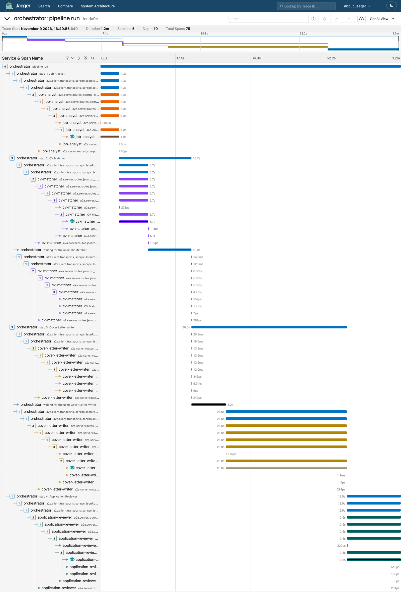
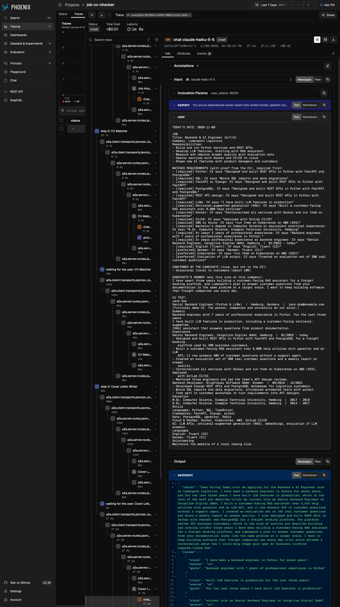

# Job Ad & CV Checker

Four AI agents that read a job ad, check a CV against it, write an honest cover letter, and review the whole application like a recruiter. They talk to each other over the **A2A (Agent-to-Agent) protocol**, run on **local models by default**, and ask you when something can't be decided from the CV.

A learning project for A2A and multi-agent design: small, commented at every A2A concept, and measured rather than guessed.

> **Privacy:** with the default local models, nothing leaves your machine. With a Claude preset (`haiku`, `haiku-sonnet`), **the job ad, the full CV text, the letter and your answers are sent to Anthropic.** Use local models for any CV that shouldn't leave your machine.

## What it does

1. **Job Analyst** turns the job ad into structured requirements, each required or preferred.
2. **CV Matcher** checks every requirement against the CV.
   - An item counts as found only with an exact quote from the CV, which plain Python checks.
   - It asks you yes/no about anything unclear, and always about what a CV can't show (willingness to travel, start date, availability).
   - The result is a match score (required items count 2 points, preferred 1).
3. **Cover Letter Writer** asks you "why this role?", then writes a letter from proven items only. Every claim must quote the CV or your answer; unproven claims trigger a rewrite.
4. **Application Reviewer** reads the ad, the report, the CV and the letter, and only reports: a verdict (shortlist / maybe / reject), the top weaknesses, overclaims and generic sentences (each quote checked against the letter), and likely interview questions.
5. **Orchestrator** runs them in a fixed order with one command and saves the whole run, including the model, tokens, cost and time of every step.

## Architecture

```
            ┌───────────────── you, in the terminal ─────────────────┐
            │  yes/no questions from the CV Matcher, "why this role?" │
            └───────────────────────────▲─────────────────────────────┘
                                        │ human in the loop: an agent's task pauses
                                        │ (A2A "input-required") until you answer
  job ad + CV ──▶ ┌─────────────────────┴───────┐
                  │ Orchestrator: plain Python,  │  1. reads every agent card
                  │ fixed routing, one context   │     (GET /.well-known/agent-card.json)
                  └─────────────┬────────────────┘  2. calls the agents in order
                                │ A2A: JSON-RPC over HTTP; results come back as artifacts
       ┌────────────────┬───────┴────────┬───────────────────┐
       ▼                ▼                ▼                   ▼
  Job Analyst       CV Matcher      Cover Letter        Application
  :9001             :9002           Writer :9003        Reviewer :9004
  ad → requirements requirements +  letter + checked    verdict, overclaims,
                    CV → score      claims              interview questions
                    (asks yes/no)   (asks "why?")
       └────────────────┴───────┬────────┴───────────────────┘
                                ▼
            agents/model_client.py: the only place that calls a model
            Ollama on your machine (default)  │  Anthropic API (optional, budget guard)
```

- Each agent is its own HTTP server with a public **agent card**.
- A request creates a **task** with a status (`working`, `input-required`, `completed`, `failed`); results come back as **artifacts**.
- A paused task keeps its half-finished work, so your answer continues the same task.

## Presets

The model belongs to the agent: each agent reads its model when it starts and reports it with every result. A preset sets all four at once.

| Preset | Models | Time per run | Cost per run | When to use it |
|---|---|---|---|---|
| `local` (default) | `ministral-3:8b`; Reviewer `granite4.1:8b` | about 2.5 min | $0 | Real CVs: nothing leaves your machine. The Reviewer is a different model from the agents it reviews. |
| `haiku` | Claude Haiku for all four | about 45–60 s | about $0.008 | The fictional demo CVs, or data you're fine sending to Anthropic; faster and cleaner requirement lists. The Reviewer shares the agents' model family. |
| `haiku-sonnet` | Claude Haiku; Reviewer Claude Sonnet | 44 s (one run) | $0.038 (one run) | Like `haiku`, but with a Reviewer from another model family, which did better in a tiny test. About five times the cost of `haiku`. |

Times and costs are from runs on the fictional Jane Doe CV with scripted answers.

A Claude preset checks `ANTHROPIC_API_KEY` when each agent starts; if it's missing or rejected, the agent doesn't start. There is never a silent fallback to another model. Every Claude call goes through a budget guard: $0.50 per run and $3.00 in total by default, counted in `results/cloud_spend.json`.

## How to run

**You need:** Python 3.11, [Ollama](https://ollama.com) with `ministral-3:8b` and `granite4.1:8b` (about 12 GB), and optionally Docker Desktop and an Anthropic API key.

```bash
python3.11 -m venv .venv && source .venv/bin/activate
pip install -r requirements.txt
cp .env.example .env                 # models, Ollama URL; ANTHROPIC_API_KEY only for Claude presets
python -m pytest                     # 131 tests of the plain-Python logic, no models needed
```

**Without Docker** (two terminals):

```bash
python scripts/start_agents.py                    # terminal 1: all four agents; add --preset haiku or haiku-sonnet
python -m orchestrator samples/demo/job_ad_demo.txt samples/demo/cv_jane_doe.pdf   # terminal 2: answer the questions
```

**With Docker** (the agents in containers; Ollama stays on your machine; the orchestrator stays in your terminal):

```bash
python scripts/docker_up.py                       # add --preset haiku|haiku-sonnet, --tracing, --content
python -m orchestrator samples/demo/job_ad_demo.txt samples/demo/cv_jane_doe.pdf
python scripts/docker_up.py --down
```

- `--answers samples/demo/answers_jane_doe.json` gives scripted answers instead of you typing.
- Each run is saved in `results/runs/<date-time>/`.
- More, including one agent at a time: [docs/code-tour.md](docs/code-tour.md).

## Results in brief

All on fictional CVs and job ads, except the scorecard, which also uses 7 real job ads (not committed). Full write-up: [docs/comparison-local-vs-haiku.md](docs/comparison-local-vs-haiku.md).

- **Job Analyst scorecard: local vs Haiku** (7 real AI job ads; a small, hand-made scorecard; the latest scores are *model-read*, waiting for a human spot-check):

  | | Local | Haiku |
  |---|---|---|
  | Items in the wrong field (required vs preferred), before → after the schema fix | 3 → 0 | 7 → 0 |
  | Vague items / invented facts | 15 / 0 | 5 / 0 |
  | Seconds per ad | 24 | 8 |

- **Dummy CVs vs predictions** (three fictional CVs; expected outcomes written and committed before any run):

  | CV | Predicted | Local | Haiku |
  |---|---|---|---|
  | Jane Doe | 85–100%, shortlist | 100%, shortlist | 100%, shortlist |
  | Robin Sample | 55–75%, maybe | 74%, maybe | 76% (1 point over), maybe |
  | Casey Placeholder | 0–20%, reject | 10%, reject | 3%, reject |

  5 of 6 landed in their predicted range. The same strong CV run three times with Haiku scored 100% each time, but got the verdicts shortlist, maybe, shortlist.
- **Planted-error test, a tiny test** (one letter with 4 planted mistakes, listed before the runs; 2 runs per model):
  - Haiku caught 3 of 4 in both runs (it missed an irrelevant claim);
  - Sonnet caught 4 of 4 in both runs;
  - no run raised a false alarm.

  It shows what happened here, not how good a reviewer is in general.

## Observability

Off by default. With `TRACING=on`, one run becomes **one OpenTelemetry trace** across all five processes:
- a span per step;
- the A2A client and server spans, joined across processes;
- a span per model call (model, tokens, cost);
- the grounding checks;
- the time the run waited for your answers.

The traces go to Jaeger and Phoenix, which start with `docker_up.py --tracing`.

| Jaeger: where the time goes, across 5 services | Phoenix: what a model call read and wrote |
|---|---|
|  |  |

Both pictures show the same run: the fictional Jane Doe on Claude Haiku. Jaeger shows the 10 s and 8 s waits for the user's answers. Phoenix shows the letter writer's prompt (with the CV) and the letter it wrote, recorded because content recording was on.

The viewers use the same ports as the labour-law project's viewers, so stop those first. How to read a trace: [docs/observability.md](docs/observability.md).

## Privacy design

- **Local by default.** Data goes to Anthropic only with a Claude preset or a `claude-...` model name, and every agent then says so when it starts.
- **The API key** is read only by the model client and handed to the SDK. It's never printed, logged, put into a trace, or built into the Docker image. Containers get it as an environment variable at start, only with a Claude preset.
- **Real CVs stay out.** Measuring runs use only the fictional CVs in `samples/demo/`. Your own CVs, job ads, results and `.env` are gitignored, and `.dockerignore` lets only `agents/`, `prompts/` and `requirements.txt` into the image (checked by listing the image's files).
- **Traces hold no texts unless asked.** Prompts, CV text, letters and answers are recorded only with `TRACE_CONTENT=on` *and* the run's permission, which the orchestrator gives only for the demo CVs. The orchestrator refuses other CVs while content recording is on.
- **Everything listens on 127.0.0.1 only.**
- **A known gap:** a paused task keeps its inputs, including the CV text, in the agent's in-memory task store until the agent stops (backlog item 8).

## Limitations

- **Weak proof:** a quote can be real without proving the requirement.
- **Requirement handling:** "A, B or C" alternatives become separate required items, and Haiku sometimes leaves out a requirement altogether.
- **Unstable verdicts:** Claude takes no temperature here, so verdicts for the same application can differ between runs.
- **Reviewer false positives:** its findings are a second opinion, not facts.
- **Partial claim check:** the letter's claims are checked, but a factual sentence the model didn't list as a claim isn't.
- **Narrow testing:** 7 real ads of one kind, 3 short made-up ads and four fictional CVs. Several scores are model-read.
- **Not production-grade:** terminal only, paused tasks are lost on restart, containers run as root, and the trace viewers keep data only briefly.

All 25 open items: [docs/backlog.md](docs/backlog.md).

## Docs

- [decisions.md](docs/decisions.md): every design decision and why (8 so far).
- [comparison-local-vs-haiku.md](docs/comparison-local-vs-haiku.md): local vs Claude, before and after the fixes, the dummy CVs, the planted-error test.
- [model-comparison-job-analyst.md](docs/model-comparison-job-analyst.md): how the local model was chosen, and the scorecard rules.
- [observability.md](docs/observability.md): tracing, the two switches, what to look at in each viewer.
- [code-tour.md](docs/code-tour.md): where things are, what a run saves, single-agent tools.
- [lessons-learned.md](docs/lessons-learned.md): what this project taught me.
- [backlog.md](docs/backlog.md): open items.
- [samples/demo/expected_outcomes.md](samples/demo/expected_outcomes.md) and [samples/demo/planted_errors/planted_errors.md](samples/demo/planted_errors/planted_errors.md): the predictions written before the runs.

MIT licence.
